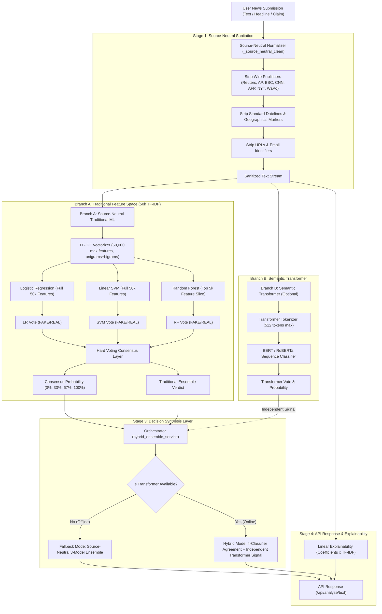
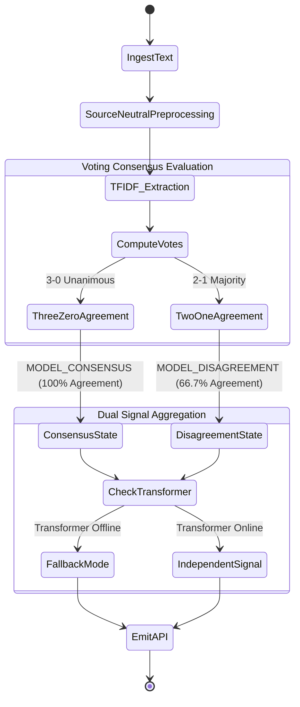
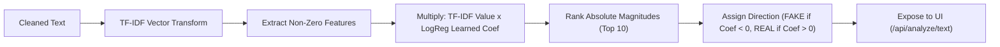

# VeriNews AI 2.0 — Model Architecture Diagram

This document illustrates the end-to-end architecture of the VeriNews AI 2.0 source-neutral hybrid prediction and verification pipeline.

---

## 1. Complete System Architecture

---

## 2. Decision Logic and Consensus States

---

## 3. Explainability Pipeline

