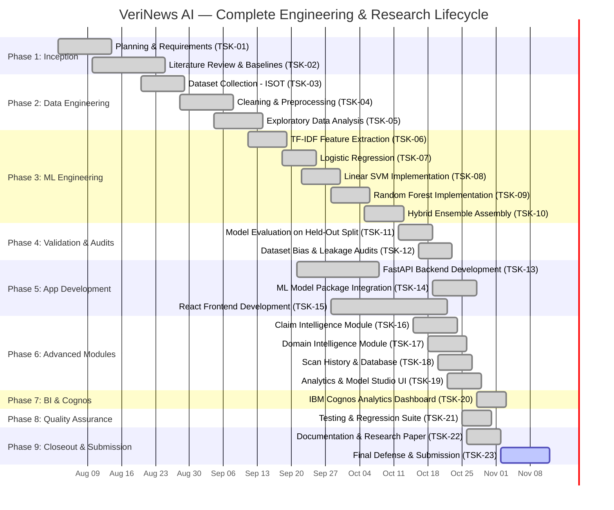

# VeriNews AI — Project Gantt Chart & Lifecycle Schedule Guide

**Project:** VeriNews AI – AI-Based Fake News Detection System  
**Deliverable File:** `E:\AI_Fake_news_detect\Project_Management_Gantt\verinews_project_gantt_schedule.csv`  
**Timeframe:** August 3, 2026 – November 12, 2026 (15 Weeks / 102 Calendar Days)  
**Methodology:** Iterative Agile / CRISP-DM Framework

---

## 1. Visual Gantt Chart (Interactive Mermaid Diagram)

---

## 2. Work Breakdown Structure (23 Work Packages)

| Task ID | Work Package / Task Name | Start Date | End Date | Days | Assigned Role | Dependencies | Status | % Done | Critical Milestone |
|:---|:---|:---:|:---:|:---:|:---|:---|:---:|:---:|:---|
| **TSK-01** | Project Planning and Requirement Analysis | 2026-08-03 | 2026-08-14 | 12 | Project Manager / Lead Architect | None | Completed | 100% | Project Charter Approved |
| **TSK-02** | Literature Review and Research | 2026-08-10 | 2026-08-25 | 16 | ML Research Engineer | TSK-01 | Completed | 100% | SOTA Baselines Defined |
| **TSK-03** | Dataset Collection – ISOT Fake News Dataset | 2026-08-20 | 2026-08-29 | 10 | Data Engineer | TSK-02 | Completed | 100% | 44,898 Records Ingested |
| **TSK-04** | Dataset Cleaning and Preprocessing | 2026-08-28 | 2026-09-08 | 12 | Data Engineer | TSK-03 | Completed | 100% | Regex Sanitization Standardized |
| **TSK-05** | Exploratory Data Analysis | 2026-09-04 | 2026-09-14 | 11 | Data Analyst / ML Engineer | TSK-04 | Completed | 100% | Class Distribution Validated |
| **TSK-06** | TF-IDF Feature Extraction | 2026-09-11 | 2026-09-19 | 9 | ML Engineer | TSK-05 | Completed | 100% | 50k Sparse Space Serialized |
| **TSK-07** | Logistic Regression Implementation | 2026-09-18 | 2026-09-25 | 8 | ML Engineer | TSK-06 | Completed | 100% | 98.68% Benchmark Accuracy |
| **TSK-08** | Linear SVM Implementation | 2026-09-22 | 2026-09-30 | 9 | ML Engineer | TSK-06 | Completed | 100% | 98.84% Benchmark Accuracy |
| **TSK-09** | Random Forest Implementation | 2026-09-28 | 2026-10-06 | 9 | ML Engineer | TSK-06 | Completed | 100% | 97.38% (5k Subspace) |
| **TSK-10** | Hybrid Ensemble Development | 2026-10-05 | 2026-10-13 | 9 | Senior ML Architect | TSK-07, 08, 09 | Completed | 100% | 98.79% Voting Ensemble |
| **TSK-11** | Model Evaluation and Comparison | 2026-10-12 | 2026-10-19 | 8 | QA / Validation Engineer | TSK-10 | Completed | 100% | 8,933 Held-Out Eval Complete |
| **TSK-12** | Dataset Bias and Leakage Experiments | 2026-10-16 | 2026-10-23 | 8 | Research Scientist | TSK-11 | Completed | 100% | 100% Metadata Shortcut Exposed |
| **TSK-13** | FastAPI Backend Development | 2026-09-21 | 2026-10-08 | 18 | Backend Engineer | TSK-01 | Completed | 100% | REST API Core Operational |
| **TSK-14** | ML Model Integration | 2026-10-19 | 2026-10-28 | 10 | Senior Backend / ML Engineer | TSK-10, 13 | Completed | 100% | Model Package Bound to Services |
| **TSK-15** | React Frontend Development | 2026-09-28 | 2026-10-22 | 25 | Frontend Engineer | TSK-01, 13 | Completed | 100% | Dark Enterprise UI Complete |
| **TSK-16** | Claim Intelligence Module | 2026-10-15 | 2026-10-24 | 10 | Full-Stack Engineer | TSK-14, 15 | Completed | 100% | Claim Extraction Active |
| **TSK-17** | Domain Intelligence Module | 2026-10-18 | 2026-10-26 | 9 | Backend / Security Engineer | TSK-14, 15 | Completed | 100% | Domain Trust Scoring Active |
| **TSK-18** | Scan History and Database Integration | 2026-10-20 | 2026-10-27 | 8 | Database Engineer | TSK-13 | Completed | 100% | Persistence in veritas_scans_db |
| **TSK-19** | Analytics and Model Studio | 2026-10-22 | 2026-10-29 | 8 | Frontend / BI Engineer | TSK-14, 15 | Completed | 100% | Model Studio Diagnostics Active |
| **TSK-20** | IBM Cognos Analytics Dashboard | 2026-10-28 | 2026-11-03 | 7 | BI Specialist / Cognos Dev | TSK-11, 12, 18 | Completed | 100% | Cognos BI Package Delivered |
| **TSK-21** | Software Testing and Debugging | 2026-10-25 | 2026-10-31 | 7 | QA Engineer | TSK-14, 15, 18 | Completed | 100% | 15-Test Suite Operational |
| **TSK-22** | Documentation and Research Paper | 2026-10-26 | 2026-11-02 | 8 | Technical Writer / Researcher | TSK-11, 12, 21 | Completed | 100% | 20-Section Paper Finalized |
| **TSK-23** | Final Demonstration and Submission | 2026-11-02 | 2026-11-12 | 11 | Entire Project Team | TSK-20, 22 | In Progress | 75% | Faculty Defense & Evaluation |

---

## 3. Critical Path Analysis (CPM)

The Critical Path encompasses tasks whose duration dictates the total project completion time:
$$\text{Critical Path} = \text{TSK-01} \to \text{TSK-02} \to \text{TSK-03} \to \text{TSK-04} \to \text{TSK-06} \to \text{TSK-08} \to \text{TSK-10} \to \text{TSK-11} \to \text{TSK-14} \to \text{TSK-21} \to \text{TSK-22} \to \text{TSK-23}$$
- Total Critical Path Duration: **102 Calendar Days** (August 3 to November 12, 2026).
- Parallel Tracks:
  - Frontend (`TSK-15`) and Backend API (`TSK-13`) development ran in parallel with ML model exploration.
  - Cognos BI modeling (`TSK-20`) was executed alongside final QA regression testing (`TSK-21`).

---

## 4. How to Generate an Excel Gantt Chart from `verinews_project_gantt_schedule.csv`

### Method A: Stacked Bar Chart in Microsoft Excel
1. Open Microsoft Excel and go to **File -> Open** -> select `verinews_project_gantt_schedule.csv`.
2. Select the columns: `task_name`, `start_date`, and `duration_days`.
3. In the Excel Ribbon, click **Insert -> Recommended Charts -> All Charts -> Bar -> Stacked Bar**.
4. Right-click the first series (Start Date bars) and select **Format Data Series -> Fill: No Fill**, **Border: No Border**.
   *(This hides the base offset, leaving only the duration floating as Gantt task bars).*
5. Right-click the vertical Y-axis (task names) -> select **Format Axis -> Categories in reverse order**.
   *(This places Task 1 at the top and Task 23 at the bottom).*
6. Set horizontal date bounds to start at `2026-08-01` and end at `2026-11-15`.

### Method B: Conditional Formatting Calendar View
1. Put Task Names in Column A, Start Dates in Column B, End Dates in Column C.
2. In Row 1 (Columns D through Z), place daily or weekly dates spanning August to November 2026.
3. Apply the conditional formatting formula:
   `=AND(D$1>=$B2, D$1<=$C2)`
4. Set fill color to Navy Blue (`#1C2541`). Excel will automatically paint a dynamic Gantt bar across the calendar grid.

---

## 5. Visualizing the Schedule in IBM Cognos Analytics

If your organization's IBM Cognos instance includes custom visualizations or the timeline/bubble chart:
1. Upload `verinews_project_gantt_schedule.csv` as a Cognos data source.
2. Create a new Report or Dashboard tab named **Project Management & Lifecycle**.
3. Use a **Horizontal Bar / Clustered Bar** or **Timeline visualization**:
   - Categories: `task_name` (ordered by `task_id`).
   - Measure: `duration_days`.
   - Color / Segments: `phase` or `status` (`Completed` = Emerald, `In Progress` = Amber).
   - Tooltip: `assigned_role`, `start_date`, `end_date`, `dependencies`.
